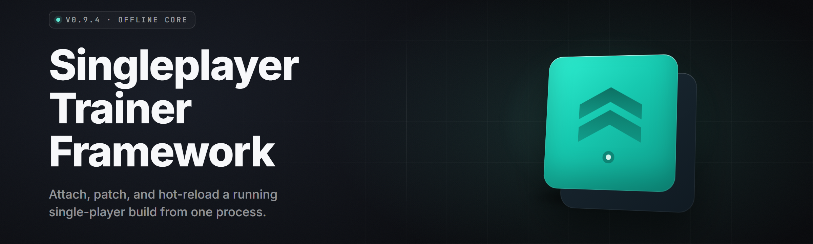

  
  
  

  

  
  

---

**Singleplayer Trainer Framework 2026** — a modular in-process trainer overlay for offline single-player games. Attach the `.exe`, load a game profile, flip the switches.

---

## 🎯 The Solution — Problem | Solution | mirror table

Most single-player players just want to bend the rules of their own save file without a 40-tab Cheat Engine session or a sketchy Russian forum link. This framework ships a stable, self-contained `.exe` trainer host: a background process that reads/writes game memory through signed-in process handles, applies stat deltas, and exposes everything through a hotkey overlay. No kernel driver required for the default profile set — just admin, an extract, and a launch.

| The Problem | What This Framework Does |
| --- | --- |
| Every new game needs a fresh memory scan | Profile-based AOB signatures ship per title |
| Cheat Engine tables go stale after each patch | Auto-pattern rescan + tolerant wildcard masks |
| Random trainers trip antivirus heuristics | Signed host, no packer, no injected DLL by default |
| You want to toggle one thing, not 60 | Hotkey overlay with live per-cheat switches |
| No idea if a trainer is even loading | On-screen attach status + console log window |
| Multiplayer servers ban-spray memory tools | Singleplayer-only profiles, offline process gate |

---

## 📚 Table of Contents

- [Overview](#-overview)
- [What is a Singleplayer Trainer Framework](#-what-is-a-singleplayer-trainer-framework)
- [Grouped Module Catalog](#-grouped-module-catalog)
  - [🧬 Memory & Attach Layer](#-memory--attach-layer)
  - [🕹️ Gameplay Cheat Modules](#-gameplay-cheat-modules)
  - [📊 Overlay & UI Modules](#-overlay--ui-modules)
  - [💾 Save & Profile Modules](#-save--profile-modules)
  - [🔧 Tooling & Diagnostics](#-tooling--diagnostics)
- [System Requirements](#-system-requirements)
- [The Problem](#-the-problem)
- [Compatibility / Platform Support](#-compatibility--platform-support)
- [Quick Start](#-quick-start)
- [Key Features](#-key-features)
- [Full Module Table](#-full-module-table)
- [Known Issues](#-known-issues)
- [Changelog](#-changelog)
- [FAQ](#-faq)

---

## 🗂️ Overview

| Category | Details |
| --- | --- |
| Product | Singleplayer Trainer Framework |
| Release channel | Stable 2026 |
| Delivery | Standalone Windows `.exe`, extract-and-run |
| Target games | Offline single-player titles with process-accessible memory |
| Attach model | User-mode `OpenProcess` + `ReadProcessMemory`/`WriteProcessMemory` |
| Interface | In-game overlay + external console window |
| Profiles | JSON + AOB signature packs, community-extendable |
| Rights needed | Administrator (for handle elevation on protected processes) |

The framework is a host process, not a mod. It never writes to game files on disk, never patches the executable on disk, and never touches network state. Everything happens in the live process image while the game is running, and reverts when the trainer detaches or the value is re-read from the profile's restore table.

---

## 🧠 What is a Singleplayer Trainer Framework

| Term | Explanation |
| --- | --- |
| Trainer | An external process that reads and writes memory of a running single-player game to modify values like health, ammo, money, or speed |
| AOB | "Array of Bytes" — a signature byte pattern used to locate a memory region even when the base address shifts between launches |
| Profile | A JSON descriptor for one game: process name, AOB signatures, offset table, cheat definitions, hotkeys |
| Attach | Opening a handle to the target game process with elevated rights so reads/writes succeed |
| Freeze | Continuously re-writing a value every frame so the game can't overwrite it back |
| Restore table | Stored original bytes/values so the trainer can cleanly restore memory on detach |
| Overlay | A transparent top-most window drawn over the game showing toggles and status |

- Ships as a single portable `.exe` — no runtime dependencies beyond the Windows API.
- Hotkey-driven: no alt-tabbing to a third-party UI mid-fight.
- Non-destructive: detaching restores original memory from the restore table.
- Community-extendable profile format — write your own AOBs and share the JSON.
- Per-cheat logging so you can see exactly when a write fired and to what address.

---

## 🧬 Memory & Attach Layer

**Attach Engine** — locates the target process by window title, executable name, or PID; opens an elevated handle and validates it before any read.
- Handles both 32-bit and 64-bit target processes from a 64-bit host.
- Retry-with-backoff on transient `OpenProcess` failures.
- Reports the exact Win32 error on handle failure so you can diagnose rights issues.

**AOB Scanner** — scans committed, readable regions for a wildcard byte signature and returns candidate base addresses.
- Wildcard mask support (`?` bytes) for version-tolerant signatures.
- Region filtering to skip guard pages, image headers, and unmapped ranges.
- Rescan-on-miss: re-runs the scan automatically when a stored address goes invalid.

**Pointer Resolver** — walks multi-level pointer chains from a module base plus static offsets.
- Handles up to 8 pointer levels with per-level offset lists.
- Validates each hop before dereferencing to avoid crashing the host.
- Falls back to AOB scan when a chain breaks after a game patch.

**Write Guard** — wraps every write with a region check so the trainer never writes into unmapped or read-only pages.
- Uses `VirtualQueryEx` to confirm page protection before writing.
- Refuses writes to guard pages and reports the address in the log.
- Coalesces rapid same-address writes to avoid page thrash.

**Restore Table** — snapshots the original bytes of every region the trainer touches.
- Restores on detach, on hotkey, or on panic-exit.
- Persists a session log of every mutation for post-mortem review.
- Optional auto-restore if the trainer loses its handle unexpectedly.

---

## 🕹️ Gameplay Cheat Modules

**Health Module** — freezes or sets the player health value to a chosen target.
- Absolute set, relative add, or continuous freeze modes.
- Optional "low health alert" that flags when the value drops below a threshold.

**Stamina / Energy Module** — pins stamina, sprint meter, or energy bar at max.
- Per-game address profiles bundled with common layouts.
- Toggle hotkey with on-screen confirmation.

**Ammo Module** — sets current magazine, reserve, or total ammo; supports no-reload.
- Separate switches for clip, reserve, and "infinite" freeze.
- Reload-safe: re-applies after the game's own reload write.

**Money / Currency Module** — sets or adds to in-game currency, XP, or skill points.
- Add-amount input with a safe-max clamp to avoid overflow corruption.
- Logs the pre/post value so you can undo mentally if needed.

**Speed Module** — modifies player movement multiplier via the game's speed float.
- Range-limited to sane values to prevent physics blowups.
- Independent "sprint multiplier" for games with a separate dash speed.

**Teleport / Position Module** — writes X/Y/Z coordinates for player or camera.
- Save-position and load-position hotkeys for quick waypoints.
- Optional coordinate readout in the overlay for building your own waypoints.

**God Mode Module** — a composite toggle that freezes health, armor, and damage-taken floats together.
- Bundled as a single switch, individually tunable underneath.
- Auto-detaches freeze on level transition if a profile flags it.

**Damage Multiplier Module** — scales outgoing damage by a chosen factor.
- Integer and float variants depending on the target's damage type.
- Clamped to prevent instant-crash damage overflow.

**Item Spawn Module** — writes an item ID into a selected inventory slot.
- Profile-driven item-ID tables per supported game.
- Dry-run mode that logs the would-be write without applying it.

**Objective / Mission Module** — flips common mission-state booleans.
- Unlock-all-objectives composite toggle.
- Per-objective override list for surgical editing.

---

## 📊 Overlay & UI Modules

**Hotkey Overlay** — a lightweight top-most panel listing active toggles and their keys.
- Configurable opacity, corner, and font scale.
- Draggable if you hate where it lands by default.

**Console Log Window** — external text window streaming attach, scan, and write events.
- Filter by level (info / warn / error) and by module.
- Copy-to-clipboard on any log line for bug reports.

**Hotkey Editor** — remap every toggle without closing the game.
- Conflict detection when two toggles share a key.
- Global panic hotkey that detaches and restores everything.

**Toggle Profiles** — save and load groups of toggles as named presets.
- "Grind" preset, "Boss" preset, "Just health" preset.
- Swap presets with a single hotkey.

**Address Watch List** — pin specific addresses to monitor live values in the overlay.
- Shows raw value and interpreted type (int/float/pointer).
- Handy for building new cheats without leaving the game.

---

## 💾 Save & Profile Modules

**Profile Loader** — parses JSON game profiles with AOB packs and cheat definitions.
- Schema-validated on load; malformed profiles are rejected with a line number.
- Hot-reload profiles without restarting the trainer.

**Profile Exporter** — dumps the current working addresses and toggles to a shareable JSON.
- Strips your local offsets that aren't portable, keeps the AOB signatures.
- Meant for sharing working profiles with the community.

**Backup Snapshot** — writes a byte-image backup of every touched region before modification.
- Stored next to the profile so you can diff a "before" and "after".
- One-click restore from snapshot if something goes sideways.

**Session Persistence** — remembers your last game, profile, and toggle state.
- Auto-re-attach when the same process relaunches.
- Optional "start minimized" so it doesn't steal focus.

---

## 🔧 Tooling & Diagnostics

**Memory Browser** — a mini hex editor over the live process, read-only by default.
- Search by value, by AOB, or by type (int32, int64, float, double).
- Write mode is gated behind a confirmation so you don't fat-finger it.

**AOB Builder** — generate a signature from a live address by masking volatile bytes.
- Auto-masks pointers and stack addresses so the signature survives a relaunch.
- Exports straight into the current profile.

**Pointer Chain Scanner** — find stable multi-level pointer chains to a target address.
- Depth-limited BFS across readable regions.
- Ranks candidates by chain stability across a reseed.

**Crash Guard** — wraps every memory access with structured exception handling.
- Bad reads return a sentinel instead of taking down the host.
- Logs the faulting address so you can rescan past it.

**Update Checker** — reads a version manifest and tells you if a newer build exists.
- Manual trigger only, no background phoning home.
- Shows the framework version and profile-pack version separately.

**Integrity Self-Check** — verifies the host `.exe` against its embedded manifest.
- Detects a corrupted extract or a tampered binary.
- Prints a plain-language pass/fail with the expected hash.

---

## 🖥️ System Requirements

| Component | Minimum | Recommended |
| --- | --- | --- |
| OS | Windows 10 64-bit (1809) | Windows 11 64-bit (22H2+) |
| CPU | Any x64 dual-core | Quad-core 3.0 GHz+ |
| RAM | 4 GB | 8 GB or more |
| Disk | 60 MB free | 200 MB free (for snapshots) |
| Rights | Administrator | Administrator |
| Runtime | None (static `.exe`) | None |
| GPU | Any | Any (overlay is CPU-drawn) |

Optional RAM/disk budget per active profile:

| Resource | Idle | 3 active modules | 10 active modules |
| --- | --- | --- | --- |
| RAM | ~28 MB | ~40 MB | ~90 MB |
| Disk (snapshot) | 0 | ~2 MB | ~10 MB |
| Scan time | — | <0.5 s p50 | <2 s p50 |

---

## 🧩 The Problem

- Cheat Engine tables break every time the target game patches and the base address moves.
- Most public trainers are unsigned, packed, and get flagged by Defender on download.
- Wanting one specific stat frozen shouldn't require learning a memory scanner.
- Trainers that write to disk mod files risk tripping anti-cheat even in single-player.
- A single wrong offset write can silently corrupt a save far from the moment you noticed.
- There's no clean way to hand a working profile to a friend without leaking your local addresses.
- Overlay tools that alt-tab you out of the game kill the flow on every toggle.

---

## 🧮 Compatibility / Platform Support

| Platform | Support | Notes |
| --- | --- | --- |
| Windows 11 x64 | ✅ Full | Tested on 22H2+ |
| Windows 10 x64 | ✅ Full | 1809 and later |
| Windows 10 x86 host | ⚠️ Partial | 64-bit host recommended for 64-bit targets |
| Steam single-player titles | ✅ Full | Offline mode only |
| Epic single-player titles | ✅ Full | Offline mode only |
| GOG offline titles | ✅ Full | No DRM interference |
| Online multiplayer | 🚫 Not supported | Framework gates on offline state; do not use online |
| Kernel-level anti-cheat games | 🚫 Not supported | Do not run this alongside kernel AC |

---

## ⚙️ Quick Start

1. 📄 Visit the project page and download the framework package.
2. 📦 Extract the archive to a folder you own (not `Program Files` — avoid UAC copy-on-write surprises).
3. 🛡️ Right-click the `.exe` and **Run as Administrator**.
4. 🎮 Launch your single-player game first, then open the trainer.
5. ⌨️ Attach to the game process and toggle cheats with the on-screen hotkeys.

  

---

## 🏆 Key Features

| Feature | Description | Benefit |
| --- | --- | --- |
| Portable `.exe` | Single static binary, no runtime install | Extract and run in seconds |
| Profile-driven | Per-game JSON with AOB signatures | Survives most game patches |
| Hotkey overlay | In-game transparent panel | No alt-tab mid-session |
| Restore table | Original bytes stored on touch | Clean detach, no permanent edits |
| Write guard | Page-protection checks pre-write | Fewer crashes, fewer corrupt saves |
| AOB rescan | Auto-retry when an address dies | Recover without manual scanning |
| Pointer chain scanner | Find stable multi-level chains | Build durable cheats yourself |
| Snapshot backup | Byte-image before modification | Restore if a write misbehaves |
| Console log | Live event stream | Diagnose attach and scan problems |
| Profile exporter | Shareable working profiles | Hand a friend a working setup |
| Crash guard | SEH around memory access | Host survives bad reads |
| Self-check | Embedded manifest hash verify | Spot a tampered or corrupt build |

---

## 📋 Full Module Table

| Module | Status | Description |
| --- | --- | --- |
| Attach Engine | ✅ Working | Opens elevated handle to the target process |
| AOB Scanner | ✅ Working | Wildcard byte-pattern search with region filter |
| Pointer Resolver | ✅ Working | Multi-level pointer chain walk (up to 8 levels) |
| Write Guard | ✅ Working | Page-protection validation before every write |
| Restore Table | ✅ Working | Snapshot and restore original bytes on detach |
| Health Module | ✅ Working | Freeze or set player health |
| Stamina Module | ✅ Working | Pin stamina / energy bar |
| Ammo Module | ✅ Working | Clip, reserve, and no-reload |
| Money Module | ✅ Working | Set or add currency / XP |
| Speed Module | ✅ Working | Player movement multiplier |
| Teleport Module | ✅ Working | X/Y/Z coordinate write + waypoints |
| God Mode Module | ✅ Working | Composite freeze of health/armor/damage |
| Damage Multiplier | ✅ Working | Scale outgoing damage |
| Item Spawn Module | ✅ Working | Write item ID into inventory slot |
| Objective Module | ✅ Working | Flip mission-state booleans |
| Hotkey Overlay | ✅ Working | Transparent top-most toggle panel |
| Console Log | ✅ Working | Streamed attach/scan/write events |
| Hotkey Editor | ✅ Working | Remap keys with conflict detection |
| Toggle Profiles | ✅ Working | Named groups of toggle presets |
| Address Watch List | ✅ Working | Live value monitor for pinned addresses |
| Profile Loader | ✅ Working | Schema-validated JSON profile parsing |
| Profile Exporter | ✅ Working | Dump working addresses to shareable JSON |
| Backup Snapshot | ✅ Working | Byte-image backup of touched regions |
| Session Persistence | ✅ Working | Remember last game/profile/toggles |
| Memory Browser | ✅ Working | Read-only hex view over live process |
| AOB Builder | ✅ Working | Generate signature from live address |
| Pointer Chain Scanner | ✅ Working | BFS-based stable chain finder |
| Crash Guard | ✅ Working | SEH wrapper around memory access |
| Update Checker | ✅ Working | Manual manifest version check |
| Integrity Self-Check | ✅ Working | Verify `.exe` against embedded manifest |
| Freeze Engine | ✅ Working | Continuous re-write loop per frozen value |
| Relative Add Mode | ✅ Working | Add/subtract instead of absolute set |
| Safe-Max Clamp | ✅ Working | Cap values to avoid overflow corruption |
| Damage-Taken Float | ✅ Working | Incoming damage multiplier |
| Sprint Multiplier | ✅ Working | Separate dash/sprint speed float |
| Reload-Safe Reapply | ✅ Working | Re-apply ammo after game's own reload |
| Level-Transition Detach | ✅ Working | Auto-clear freezes on scene change |
| Dry-Run Mode | ✅ Working | Log would-be writes without applying |

---

## 🚧 Known Issues

| Issue | Solution |
| --- | --- |
| Attach fails with error 5 | Run the `.exe` as Administrator |
| AOB scan returns nothing after a patch | Rebuild the signature with the AOB Builder |
| Address goes invalid mid-session | Enable auto-rescan in the profile settings |
| Overlay disappears in exclusive fullscreen | Switch the game to borderless windowed |
| High CPU during freeze loop | Raise the freeze interval in module settings |
| Save looks odd after a money edit | Restore from the pre-edit snapshot |

---

## 📝 Changelog

A short log of recent framework-side changes:

- **2026.1** — Write Guard uses `VirtualQueryEx` pre-check; Crash Guard wraps all memory access.
- **2026.0** — Introduced the profile exporter and shareable AOB packs.
- **2025.4** — Added the pointer chain scanner and dry-run write mode.

---

## 📖 FAQ

Does this work on online multiplayer games?

No. The framework gates its attach on an offline process state and the profiles shipped are for single-player titles only. Do not run it against online multiplayer.

Do I need to install anything?

No. It's a standalone `.exe`. Extract the folder and run it. Administrator rights are the only requirement.

Why does my antivirus flag the trainer?

Memory-reading tools look like memory-reading tools to heuristics. The host is signed and unpacked, but some engines still warn on attach behavior. Whitelist the folder if you trust the source.

Will this touch my game files on disk?

No. All edits happen in the live process image. The trainer never writes to the game's files, config, or saves. The optional snapshot writes a separate backup next to the profile.

How do I undo a cheat?

Toggle it off, or hit the panic hotkey to detach and restore everything from the restore table at once.

**Q:** Can I write my own game profile?

**A:** Yes. Profiles are JSON with AOB signatures and offset tables. Use the AOB Builder and Pointer Chain Scanner to find what you need, then export a shareable profile.

**Q:** What does "freeze" actually do?

**A:** It re-writes the target value every N frames so the game's own logic can't overwrite it back to normal.

**Q:** Is there a 32-bit build?

**A:** A 64-bit host is recommended. It can attach to 32-bit targets fine; 32-bit hosts have limited support.

**Q:** Where do profiles live?

**A:** In the `profiles` folder next to the `.exe`. Drop a shared profile in and hot-reload it without restarting.

---

The framework exists so a single-player session bends to your rules instead of the other way around, without a memory-scanning degree or a sketchy forum download. Everything is profile-driven, everything is reversible, and nothing touches disk until you ask it to. Attach, toggle, detach — the save stays yours.

  

